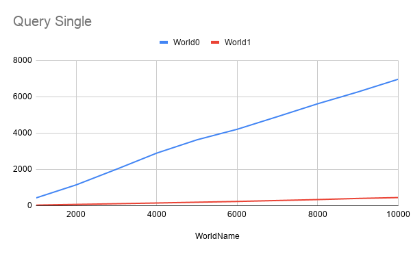
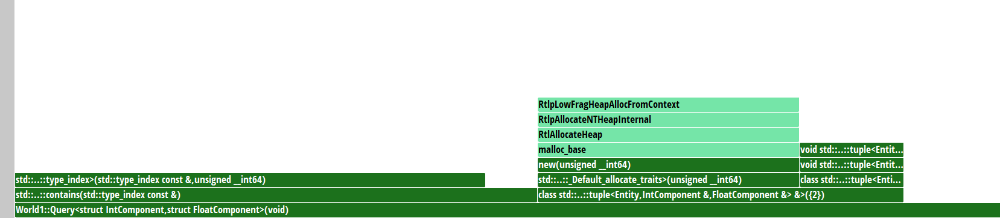
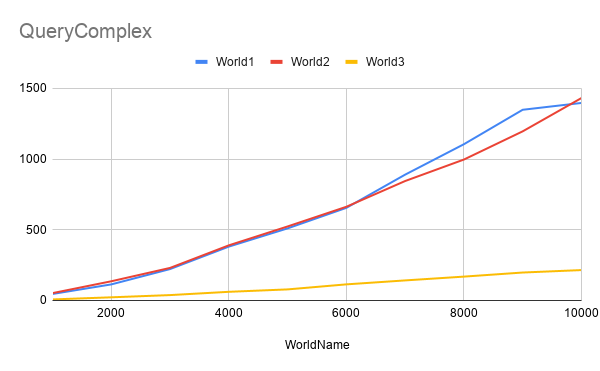
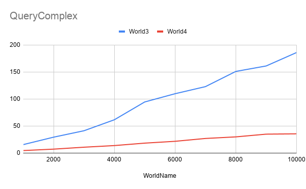

# C++ ECS

The purpose of this project is to evolve a simple ECS through guided optimisations. 
To that end it includes an experiment harness created via C++ Concepts, allowing any ECS World that fits the parameters. 
The idea is to start from ecsSimple.h, analysing that theoretically with Big O analysis, as well as empirically through tools such as VTune or Valgrind,
and finding opportunities for optimisations. 
Using the experiment harness we can then verify that the intended optimisation actually worked. 

# Analysis

Here we analyse our implementations and attempt to iteratively improve upon them. 
Our starting point is World0, and we will be focusing mainly on the Query function, 
as that is what would run every frame multiple times in a real scenario. 

## World0 -> World1

The complexity of Query for World0 is O(n * t_q * t), 
where n is the number of entities, t_q is the number of queried components, and t is the total number of components an entity might have.
This is a slight oversimplification, as likely few, and certainly not all entities have the full range of components. 

### Hypothesis
By storing the components in a Hashmap instead of a vector, 
we can reduce the expected complexity to O(n * t_q), as we can avoid searching through the t components. 

### Testing
Here we see the average time in ms for a query, 
one scenario being a query with a single component after a fresh world creation, 
another scenario being a more coomplex query, after some random additions and deletions.





Both of these graphs look linear for both Worlds, which is expected, 
as the variable we are varying is the number of Entities, which both are linear in.
World1 is much faster than World0, which is what we expected.
There are 0-10 components on each Entity, so about a 8-15x speedup is about right, 
especially considering we were doing the loop over all components twice.

## World1/World2 -> World3

Using AMD UProf (or similar tools) we can inspect the running of our program, 
to see how it behaves in a real run.
In the Flamegraph, we see that most of the time is spent in the "contains" function, 
with most of the remainder in the creation of the tuple we send back. 

It should be noted that attributing cycles to specific functions is not neccesarily super exact, 
as its based on sampling, but it can often give a good indication. 

### Hypothesis

The World1 implementation using Hashmaps causes a lot of pointer chasing to get to the data we need,
menaing a lot of seperate data lookups, which are likely not going to be in the cache. 


### Testing

World2 attempts to cut down on this by having a Hashset of just the types, instead of a Hashmap from the types to the actual data. 
This turns out to make no difference, as just getting to the types is still the same amount of pointer chasing. 

In World 3 we instead introduce a bitset, where each bit corresponds to a component type. 
That way, all the data we need to determine whether an Entity has the needed components, 
is stored sequentially in memory, allowing for much more effecient data processing. 



As we can see, the bitset is indeed much more effecient. 

## World3 -> World4 (Sparse Set ECS Implementation)

### Hypothesis
We saw large improvements when we reduced the pointer chasing of the check of which entities had the right components.
A similar improvement to the cache effeciency of reading and getting the components data will likely result in a similar improvement. 

### Testing

We introduce a seperate vector for each component type, allowing for dense storage and lookup of each component. 
Alongside each of these component vectors, we have a sparse vector mapping EntityId to the index in the component vector, 
allowing us to easily lookup in the correct place, these simple array lookups rather than the pointer chasing of the previous implementation,
should be substantially faster. 
We also introduce a "FreeIndexes" array to reuse deleted component slots, rather than eternally growing the arrays. 



We do indeed see a massive improvement to the runtime in World4. 

# Building

> **Windows only.** Linux support has not been tested.

The project uses CMake with vcpkg for dependency management.

Required tools:

- CMake (3.20+)
- Ninja
- vcpkg
- MSVC toolchain + Windows SDK (Visual Studio Build Tools is sufficient; full Visual Studio IDE is optional)

1. Clone the repository
2. Ensure `VCPKG_ROOT` is set to your vcpkg installation
3. Open an x64 MSVC developer shell (required for configure, or any time the build cache is recreated)
4. Run:

```
cmake --preset debug
cmake --build --preset debug
```

> Note: A plain command prompt is not guaranteed to work unless your environment already resolves to x64 `cl.exe`.

The executable is output to `build/debug/ECSExperiments.exe`.

Subsequent rebuilds after code changes only need:

```
cmake --build --preset debug
```

## clang-tidy

`clang-tidy` is enabled during normal builds by default (`ENABLE_CLANG_TIDY_ON_BUILD=ON`).

To disable it for faster local builds:

```
cmake --preset debug -DENABLE_CLANG_TIDY_ON_BUILD=OFF
```

You can also run it manually via the dedicated target:

```
cmake --build --preset debug --target tidy
```

## Opening in Visual Studio

Open the repo folder via **File → Open → CMake Project** and select `CMakeLists.txt`. Visual Studio will configure automatically.

## Dependencies

The project uses a `vcpkg.json` manifest for dependency resolution. Dependencies are restored automatically during the configure step.


